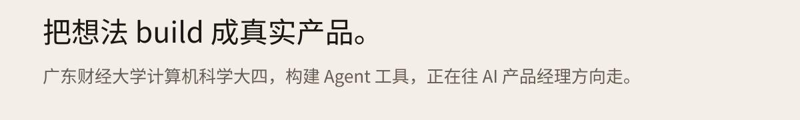
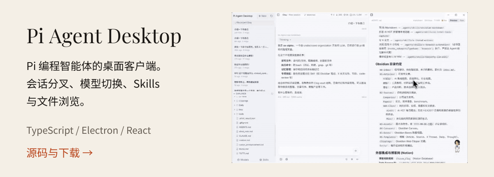
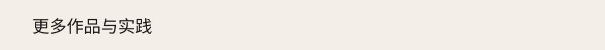
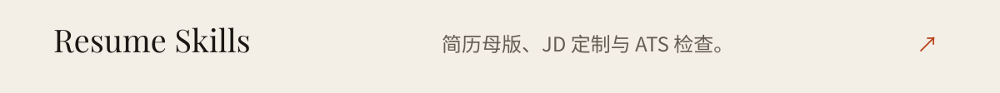
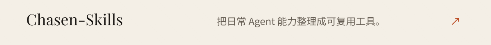
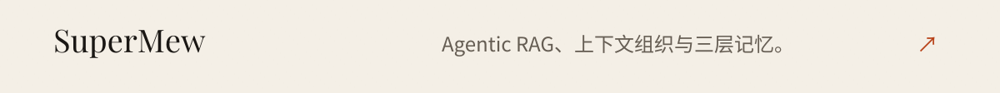
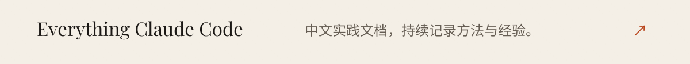
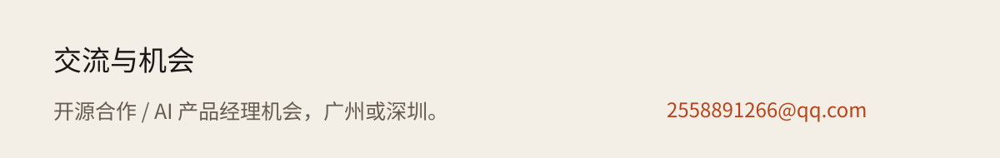

<!-- Original Remotion opening adapted for this profile: complete wordmark sequence, no 3D portrait. -->
<!-- Theme aware: every panel is a <picture> with a dark and a light source, so the
     sheet follows the reader's GitHub colour mode instead of staying paper-white. -->

<a href="https://chasen-intro.vercel.app/"><picture>
<source media="(prefers-reduced-motion: reduce) and (max-width: 600px) and (prefers-color-scheme: dark)" srcset="./assets/profile-v3/dark/opening-mobile-dark-poster.webp"/>
<source media="(prefers-reduced-motion: reduce) and (max-width: 600px)" srcset="./assets/profile-v3/opening-mobile-poster.webp"/>
<source media="(prefers-reduced-motion: reduce) and (prefers-color-scheme: dark)" srcset="./assets/profile-v3/dark/opening-dark-poster.webp"/>
<source media="(prefers-reduced-motion: reduce)" srcset="./assets/profile-v2/opening-poster.webp"/>
<source media="(max-width: 600px) and (prefers-color-scheme: dark)" srcset="./assets/profile-v3/dark/opening-mobile-dark.webp"/>
<source media="(max-width: 600px)" srcset="./assets/profile-v3/opening-mobile.webp"/>
<source media="(prefers-color-scheme: dark)" srcset="./assets/profile-v3/dark/opening-dark.webp"/>

</picture></a>

<picture><source media="(max-width: 600px) and (prefers-color-scheme: dark)" srcset="./assets/profile-v3/dark/intro-mobile.svg"/><source media="(max-width: 600px)" srcset="./assets/profile-v3/intro-mobile.svg"/><source media="(prefers-color-scheme: dark)" srcset="./assets/profile-v3/dark/intro.svg"/></picture>

<a href="https://github.com/Chasen-Liao/pi-agent-desktop"><picture><source media="(max-width: 600px) and (prefers-color-scheme: dark)" srcset="./assets/profile-v3/dark/pi-mobile.svg"/><source media="(max-width: 600px)" srcset="./assets/profile-v3/pi-mobile.svg"/><source media="(prefers-color-scheme: dark)" srcset="./assets/profile-v3/dark/pi.svg"/></picture></a>

<picture><source media="(max-width: 600px) and (prefers-color-scheme: dark)" srcset="./assets/profile-v3/dark/work-heading-mobile.svg"/><source media="(max-width: 600px)" srcset="./assets/profile-v3/work-heading-mobile.svg"/><source media="(prefers-color-scheme: dark)" srcset="./assets/profile-v3/dark/work-heading.svg"/></picture>

<a href="https://github.com/Chasen-Liao/resume-skills"><picture><source media="(max-width: 600px) and (prefers-color-scheme: dark)" srcset="./assets/profile-v3/dark/resume-mobile.svg"/><source media="(max-width: 600px)" srcset="./assets/profile-v3/resume-mobile.svg"/><source media="(prefers-color-scheme: dark)" srcset="./assets/profile-v3/dark/resume.svg"/></picture></a>

<a href="https://github.com/Chasen-Liao/Chasen-Skills"><picture><source media="(max-width: 600px) and (prefers-color-scheme: dark)" srcset="./assets/profile-v3/dark/skills-mobile.svg"/><source media="(max-width: 600px)" srcset="./assets/profile-v3/skills-mobile.svg"/><source media="(prefers-color-scheme: dark)" srcset="./assets/profile-v3/dark/skills.svg"/></picture></a>

<a href="https://github.com/Chasen-Liao/SuperMew"><picture><source media="(max-width: 600px) and (prefers-color-scheme: dark)" srcset="./assets/profile-v3/dark/supermew-mobile.svg"/><source media="(max-width: 600px)" srcset="./assets/profile-v3/supermew-mobile.svg"/><source media="(prefers-color-scheme: dark)" srcset="./assets/profile-v3/dark/supermew.svg"/></picture></a>

<a href="https://github.com/Chasen-Liao/Everything-claude-code-Doc"><picture><source media="(max-width: 600px) and (prefers-color-scheme: dark)" srcset="./assets/profile-v3/dark/ecc-mobile.svg"/><source media="(max-width: 600px)" srcset="./assets/profile-v3/ecc-mobile.svg"/><source media="(prefers-color-scheme: dark)" srcset="./assets/profile-v3/dark/ecc.svg"/></picture></a>

<a href="mailto:2558891266@qq.com"><picture><source media="(max-width: 600px) and (prefers-color-scheme: dark)" srcset="./assets/profile-v3/dark/contact-mobile.svg"/><source media="(max-width: 600px)" srcset="./assets/profile-v3/contact-mobile.svg"/><source media="(prefers-color-scheme: dark)" srcset="./assets/profile-v3/dark/contact.svg"/></picture></a>

<a href="https://chasen-intro.vercel.app/">个人站</a> · <a href="https://x.com/chasen_liao">X 构建记录</a> · <a href="https://chasen-clog.cc.cd/">博客</a> · <a href="https://github.com/Chasen-Liao?tab=repositories">全部仓库</a>

文字版介绍与作品链接

我是 Chasen，广东财经大学计算机科学大四，一边实习一边构建 AI 产品与工具。正在往 AI 产品经理方向走，关注广州 / 深圳的校招机会。

<ul>
<li><a href="https://github.com/Chasen-Liao/pi-agent-desktop">Pi Agent Desktop</a>：基于 pi-web 继续开发的 Pi 桌面客户端，支持会话分叉、分支导航、模型切换、Skills 与文件浏览。面向 Windows、macOS、Linux。</li>
<li><a href="https://github.com/Chasen-Liao/resume-skills">Resume Skills</a>：从真实经历建立母版，按 JD 定制，检查 ATS 可读性，支持本地 Canvas 微调。</li>
<li><a href="https://github.com/Chasen-Liao/Chasen-Skills">Chasen-Skills</a>：日常使用的个人 Agent Skills，包括并行编排、X 内容分析、AI 热点雷达、个人 IP 资产制作。</li>
<li><a href="https://github.com/Chasen-Liao/SuperMew">SuperMew</a>：Agentic RAG、Context Engineering 与三层记忆架构。</li>
<li><a href="https://github.com/Chasen-Liao/Everything-claude-code-Doc">Everything Claude Code 中文实践文档</a>：持续整理工具使用方法与配置实践。</li>
</ul>
日常使用 TypeScript、React、Electron、Python，在 X 与博客分享实测和构建记录。联系：<a href="mailto:2558891266@qq.com">2558891266@qq.com</a>。

GitHub 贡献
<picture><source media="(prefers-reduced-motion: reduce)" srcset="./assets/profile/contributions-static.svg" /><source media="(prefers-color-scheme: dark)" srcset="https://raw.githubusercontent.com/Chasen-Liao/Chasen-Liao/output/github-contribution-grid-snake-dark.svg" /></picture>

