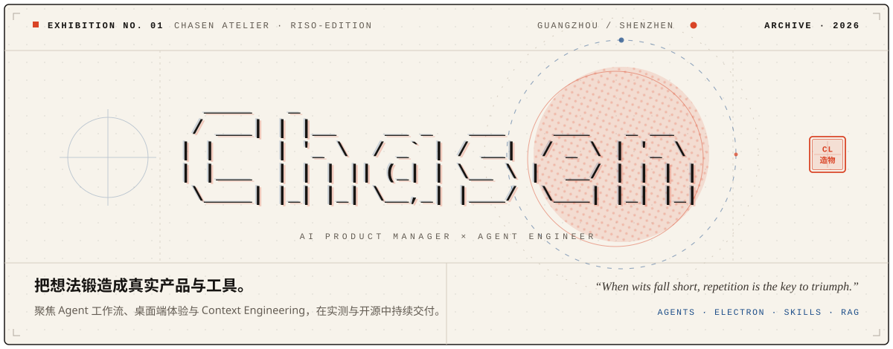
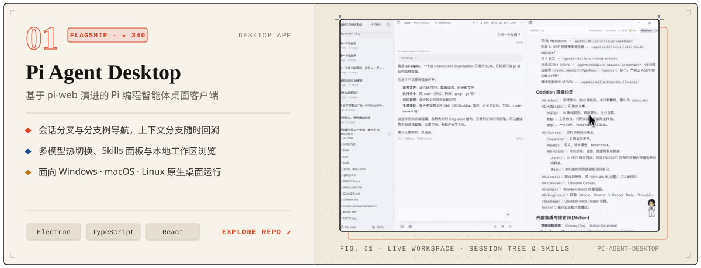
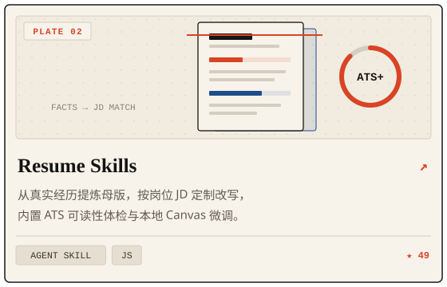
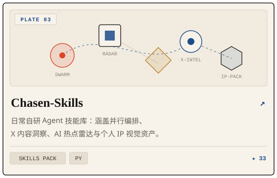
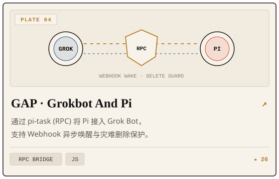
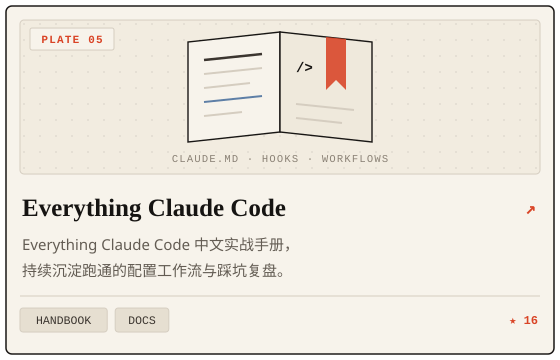
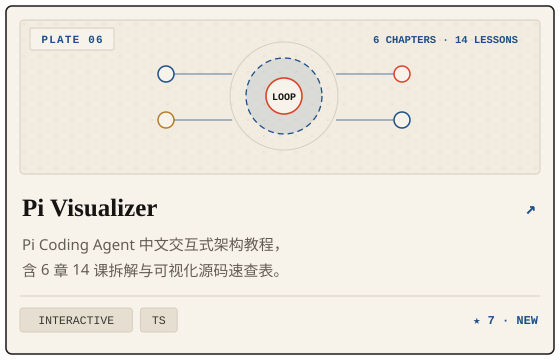
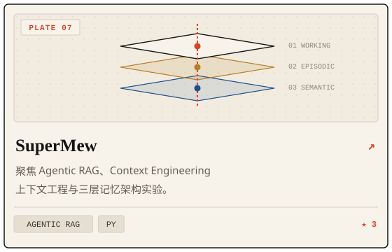
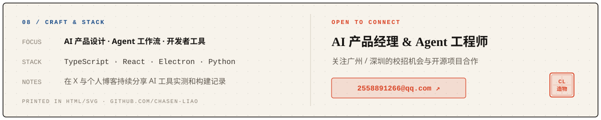

<!-- Chasen Atelier · Riso-Editorial GitHub Profile -->

<a href="https://chasen-intro.vercel.app/"><picture><source media="(max-width: 600px) and (prefers-color-scheme: dark)" srcset="./assets/atelier/dark/hero-mobile.svg"/><source media="(max-width: 600px)" srcset="./assets/atelier/hero-mobile.svg"/><source media="(prefers-color-scheme: dark)" srcset="./assets/atelier/dark/hero.svg"/></picture></a>

<a href="https://github.com/Chasen-Liao/pi-agent-desktop"><picture><source media="(max-width: 600px) and (prefers-color-scheme: dark)" srcset="./assets/atelier/dark/flagship-pi-mobile.svg"/><source media="(max-width: 600px)" srcset="./assets/atelier/flagship-pi-mobile.svg"/><source media="(prefers-color-scheme: dark)" srcset="./assets/atelier/dark/flagship-pi.svg"/></picture></a>

<picture><source media="(max-width: 600px) and (prefers-color-scheme: dark)" srcset="./assets/atelier/dark/divider-works-mobile.svg"/><source media="(max-width: 600px)" srcset="./assets/atelier/divider-works-mobile.svg"/><source media="(prefers-color-scheme: dark)" srcset="./assets/atelier/dark/divider-works.svg"/></picture>

<a href="https://github.com/Chasen-Liao/resume-skills"><picture><source media="(prefers-color-scheme: dark)" srcset="./assets/atelier/dark/card-resume.svg"/></picture></a> <a href="https://github.com/Chasen-Liao/Chasen-Skills"><picture><source media="(prefers-color-scheme: dark)" srcset="./assets/atelier/dark/card-skills.svg"/></picture></a>

<a href="https://github.com/Chasen-Liao/grokbot-and-pi"><picture><source media="(prefers-color-scheme: dark)" srcset="./assets/atelier/dark/card-gap.svg"/></picture></a> <a href="https://github.com/Chasen-Liao/Everything-claude-code-Doc"><picture><source media="(prefers-color-scheme: dark)" srcset="./assets/atelier/dark/card-ecc.svg"/></picture></a>

<a href="https://github.com/Chasen-Liao/pi-visualizer"><picture><source media="(prefers-color-scheme: dark)" srcset="./assets/atelier/dark/card-visualizer.svg"/></picture></a> <a href="https://github.com/Chasen-Liao/SuperMew"><picture><source media="(prefers-color-scheme: dark)" srcset="./assets/atelier/dark/card-supermew.svg"/></picture></a>

<a href="mailto:2558891266@qq.com"><picture><source media="(max-width: 600px) and (prefers-color-scheme: dark)" srcset="./assets/atelier/dark/colophon-mobile.svg"/><source media="(max-width: 600px)" srcset="./assets/atelier/colophon-mobile.svg"/><source media="(prefers-color-scheme: dark)" srcset="./assets/atelier/dark/colophon.svg"/></picture></a>

<a href="https://chasen-intro.vercel.app/">个人站</a> · <a href="https://x.com/chasen_liao">X 构建记录</a> · <a href="https://chasen-clog.cc.cd/">博客</a> · <a href="https://github.com/Chasen-Liao?tab=repositories">全部仓库</a> · <a href="mailto:2558891266@qq.com">Email</a>

文字版介绍与作品索引

我是 Chasen，一边实习一边构建 AI 产品与工具。定位：AI 产品经理 &amp; Agent 工程师，关注广州 / 深圳的校招机会与开源合作。

<ul>
<li><a href="https://github.com/Chasen-Liao/pi-agent-desktop">Pi Agent Desktop</a>：基于 pi-web 演进的 Pi 桌面客户端，支持会话分叉、分支导航、模型切换、Skills 与文件浏览，覆盖 Windows、macOS、Linux。</li>
<li><a href="https://github.com/Chasen-Liao/resume-skills">Resume Skills</a>：从真实经历建立母版，按 JD 定制，检查 ATS 可读性，支持本地 Canvas 微调。</li>
<li><a href="https://github.com/Chasen-Liao/Chasen-Skills">Chasen-Skills</a>：日常使用的自研 Agent Skills，涵盖并行编排、X 内容洞察、AI 热点雷达、个人 IP 资产制作。</li>
<li><a href="https://github.com/Chasen-Liao/grokbot-and-pi">GAP · Grokbot And Pi</a>：通过 pi-task (RPC) 将 Pi 接入 Grok Bot，支持 Webhook 唤醒与灾难删除保护。</li>
<li><a href="https://github.com/Chasen-Liao/Everything-claude-code-Doc">Everything Claude Code 中文实践文档</a>：持续整理工具使用方法、配置工作流与踩坑复盘。</li>
<li><a href="https://github.com/Chasen-Liao/pi-visualizer">Pi Visualizer</a>：Pi Coding Agent 中文交互式架构教程，包含 6 章 14 课与可视化源码速查表。</li>
<li><a href="https://github.com/Chasen-Liao/SuperMew">SuperMew</a>：Agentic RAG、Context Engineering 与三层记忆架构实验。</li>
</ul>
日常使用 TypeScript、React、Electron、Python，在 X 与博客分享实测与构建记录。联系：<a href="mailto:2558891266@qq.com">2558891266@qq.com</a>。

GitHub 贡献

<picture><source media="(prefers-reduced-motion: reduce)" srcset="./assets/profile/contributions-static.svg" /><source media="(prefers-color-scheme: dark)" srcset="https://raw.githubusercontent.com/Chasen-Liao/Chasen-Liao/output/github-contribution-grid-snake-dark.svg" /></picture>

